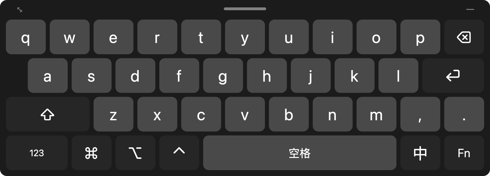
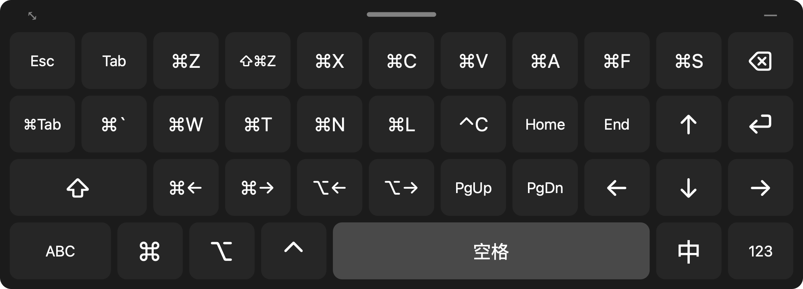

# 屏幕键盘

一个专门给远程控制用的 Mac 屏幕键盘。用车机（或任何设备）通过 UU 远程之类的软件控制 Mac 时，车机自带的输入法会挡住大半个画面，而且很多车机也连不了蓝牙键盘。这个 App 直接把键盘放在 Mac 屏幕上，在远程画面里点按键就能打字。



- **不抢焦点**：键盘是一个不会获得焦点的悬浮面板，点它时正在打字的窗口不受影响。
- **中文照常用**：键盘发出的是真实的按键，拼音交给 Mac 自己的输入法处理，候选词也是直接点选。“中/EN”键会直接切换 Mac 的输入法，不依赖你设置的切换快捷键。
- **大按键、可调整**：可以拖动位置、拖左上角 ⤡ 缩放、调不透明度，点右上角 — 收起成小圆点，不挡画面。
- **不需要手机、网络或配对**：只要远程软件能看到 Mac 屏幕、能点鼠标就行。
- 纯 Swift，没有第三方依赖。

## 构建和安装

```bash
./build.sh
```

```bash
open build/RemoteKeyboard.app
```

要开机自启的话，先把 `build/RemoteKeyboard.app` 拖到“应用程序”文件夹，再从菜单栏勾选“开机自动启动”。

### 辅助功能权限

第一次启动时，macOS 会请求权限。到 **系统设置 → 隐私与安全性 → 辅助功能**，打开“屏幕键盘”的开关。没授权时，键盘顶部会显示提示，点它就能跳到设置页。

> 每次重新构建，App 的签名都会变，macOS 可能会认为它是一个新 App。如果按键突然没反应，在辅助功能列表里把旧的“屏幕键盘”删掉，再重新授权。

## 使用

| 面板 | 内容 |
|---|---|
| 字母 | QWERTY、⇧、逗号句号、⌫、⏎ |
| 123 / #+= | 数字和全部 ASCII 符号 |
| Fn | Esc、Tab、方向键、Home/End、PgUp/PgDn，以及常用快捷键 ⌘Z ⇧⌘Z ⌘X ⌘C ⌘V ⌘A ⌘F ⌘S ⌘Tab ⌘\` ⌘W ⌘T ⌘N ⌘L ⌃C ⌘← ⌘→ ⌥← ⌥→ |



- **修饰键** ⇧ ⌘ ⌥ ⌃：点一下只作用于下一个键，快速点两下锁定（键上出现一条横线），再点一下解除。可以组合任意快捷键，比如 ⌘ → ⇧ → 4 就是截图。
- **长按连发**：⌫ 和方向键长按会自动重复。
- **菜单栏图标**：显示/隐藏、收起/展开、大小（屏宽 40%/60%/80%/全宽）、不透明度、重置位置、开机自启、权限状态。

## 截图

`docs/` 里的图是用下面的命令生成的，不会弹出窗口：

```bash
build/RemoteKeyboard.app/Contents/MacOS/RemoteKeyboard --snapshot docs
```
