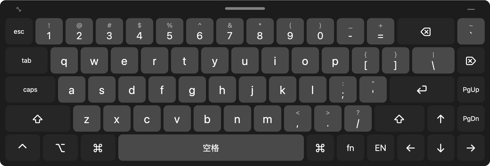
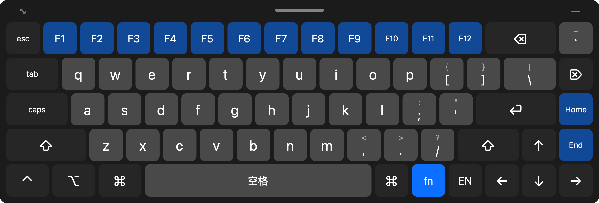

# Remote Keyboard

用车机（或任何设备）通过 UU 远程之类的软件控制 Mac 时，车机自带的输入法会挡住大半个画面，而且很多车机也连不了蓝牙键盘。这个仓库包含两个互相独立的 Mac 菜单栏 App，可以只装其中一个，也可以都装：

| App | 适合 | 怎么用 |
|---|---|---|
| **屏幕键盘**（`RemoteKeyboard.app`） | 零碎操作、快捷键、终端 | 键盘直接显示在 Mac 屏幕上，在远程画面里点按键 |
| **Telegram 输入**（`TelegramInput.app`） | 打长句、手机语音输入 | 在手机 Telegram 里给机器人发消息，文字上屏到 Mac |

两个 App 各自有菜单栏图标、辅助功能权限和开机启动设置，互不依赖。

## 屏幕键盘

直接把键盘放在 Mac 屏幕上，在远程画面里点按键就能打字。



- **不抢焦点**：键盘是一个不会获得焦点的悬浮面板，点它时正在打字的窗口不受影响。
- **中文照常用**：键盘发出的是真实的按键，拼音交给 Mac 自己的输入法处理，候选词也是直接点选。“中/EN”键会直接切换 Mac 的输入法，不依赖你设置的切换快捷键。
- **68 配列**：常见的 65% 机械键盘布局，Mac 键位，数字行、方向键、导航键都在一个面板上。
- **大按键、可调整**：可以拖动位置、拖左上角 ⤡ 缩放、调不透明度，点右上角 — 收起成小圆点，不挡画面。
- **不需要手机、网络或配对**：只要远程软件能看到 Mac 屏幕、能点鼠标就行。
- 纯 Swift，没有第三方依赖。

## 构建和安装

```bash
./build.sh
```

这会同时构建 `build/RemoteKeyboard.app` 和 `build/TelegramInput.app`。只要其中一个的话，用 `./build.sh keyboard` 或 `./build.sh telegram`。

```bash
open build/RemoteKeyboard.app
```

```bash
open build/TelegramInput.app
```

要开机自启的话，先把 App 拖到“应用程序”文件夹，再从它的菜单栏图标里勾选“开机自动启动”。

### 辅助功能权限

两个 App 都需要辅助功能权限才能往 Mac 里打字，而且**要分别授权**。第一次启动时 macOS 会请求权限：到 **系统设置 → 隐私与安全性 → 辅助功能**，打开对应 App 的开关。屏幕键盘没授权时，键盘顶部会显示提示，点它就能跳到设置页。

> `build.sh` 按 bundle id 签名，重新构建后权限不会失效。如果你授权过更早的版本，需要在辅助功能列表里把旧条目用“−”删掉再重新添加，只是打开开关不够。
>
> 排查问题时可以看日志：`/usr/bin/log stream --predicate 'subsystem == "dev.hyoban.remote-keyboard"'`

## 使用

```
esc 1 2 3 4 5 6 7 8 9 0 - =  ⌫⌫   `
tab  q w e r t y u i o p [ ] \    ⌦
caps  a s d f g h j k l ; ' ⏎⏎⏎   PgUp
⇧⇧⇧   z x c v b n m , . / ⇧⇧  ↑  PgDn
⌃  ⌥  ⌘  ━━━━ 空格 ━━━━ ⌘ fn 中 ← ↓ →
```

- **符号**：数字键和符号键像实体键帽一样显示上下两个字符，按 ⇧ 后打上面那个。
- **fn 层**：数字行变成 F1–F12，PgUp/PgDn 变成 Home/End。



- **caps**：锁定 Shift（不发送真正的 Caps Lock，因为它在 Mac 上常被用来切换中英文）。
- **中/EN**：右下角这个键直接切换 Mac 的输入法。
- **修饰键** ⇧ ⌘ ⌥ ⌃ fn：点一下只作用于下一个键，快速点两下锁定（键上出现一条横线），再点一下解除。可以组合任意快捷键，比如 ⌘ → ⇧ → 4 就是截图。
- **长按连发**：⌫、⌦ 和方向键长按会自动重复。
- **仅在远程控制时显示**（默认开启）：App 只读监听输入事件，并根据事件的来源进程判断是远程还是本地操作。通过 UU 远程（以及 ToDesk、向日葵、AnyDesk、TeamViewer、RustDesk、Parsec、屏幕共享）点击时，键盘会出现；你在 Mac 前用真实的鼠标或键盘时，键盘自动隐藏。只在来源切换的那一刻动作。滚轮事件不参与判断，避免和 Mac Mouse Fix 这类工具冲突。第一次启用时，系统可能会请求“输入监控”权限。
- **自动收起**（菜单栏里设置）：
  - **进入输入框时展开，离开时收起**（默认开启）：通过辅助功能接口监听前台 App 的焦点变化：进入输入框立即展开，离开 0.6 秒后收起（过滤焦点闪动）。只在焦点切换的那一刻动作，所以手动展开或收起后不会马上被改回去。在同一个 App 里，如果焦点从输入框落到 AXGroup 这类容器上，但前后 1 秒内没有点击（Electron App 重新渲染时常见），不算离开输入框；点了键盘以外的地方，才会收起。为了检测 VS Code、Slack 这类 Electron App 和 Chrome 里的输入框，会为这些 App 打开辅助功能支持（Chrome 需要打开 AXEnhancedUserInterface，个别窗口管理工具的动画可能受影响）。
  - **闲置后收起**：15、30 或 60 秒没点键盘就收起成小圆点，默认关闭。
- **菜单栏图标**：显示/隐藏、收起/展开、大小（屏宽 50%/70%/85%/全宽）、不透明度、重置位置、仅远程时显示、自动收起、开机自启、权限状态。

## Telegram 输入

想打一长段字，或者用手机的语音输入时，可以直接在 Telegram 里发给机器人，文字会上屏到 Mac 当前光标处。Mac 只是主动连 Telegram 的服务器拉取消息，所以不用开端口，也不用组网。它是一个独立的 App，不需要同时运行屏幕键盘。

1. 在 Telegram 里找 [@BotFather](https://t.me/BotFather)，发送 `/newbot` 创建一个机器人，拿到 token。
2. 点菜单栏的纸飞机图标 → **设置 bot token…**，粘贴 token。token 存在钥匙串里。
3. 菜单里会显示一个 6 位配对码，把它发给你的机器人。配对后，机器人只响应你这一个账号。

使用：
- **发文字**：上屏到当前光标处。单行直接输入；多行用粘贴的方式上屏，避免中间的换行被当成回车提前发出去。
- **按钮**：聊天框下方有 ⏎ ⌫ Esc Tab、方向键、⌘C ⌘V ⌘Z ⌘A ⌘Tab ⌘W ⌃C 和“中/EN”。
- **自动回车**：打开后，每条文字上屏后会再按一次回车，适合聊天、终端这类场景。
- 上屏成功后，机器人会给你的消息点 👍。超过 2 分钟的消息会被忽略，避免 Mac 重新联网时突然打出一堆字。
- 菜单栏图标在已连接并配对后变成实心。
- 注意：机器人聊天不是端到端加密的，不要用它输入密码。
- 排查问题时可以看日志：`/usr/bin/log stream --predicate 'subsystem == "dev.hyoban.telegram-input"'`

## 截图

`docs/` 里的图是用下面的命令生成的，不会弹出窗口：

```bash
build/RemoteKeyboard.app/Contents/MacOS/RemoteKeyboard --snapshot docs
```
